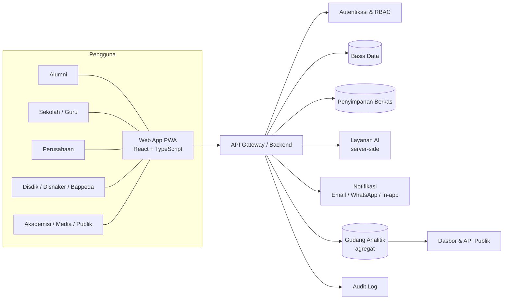
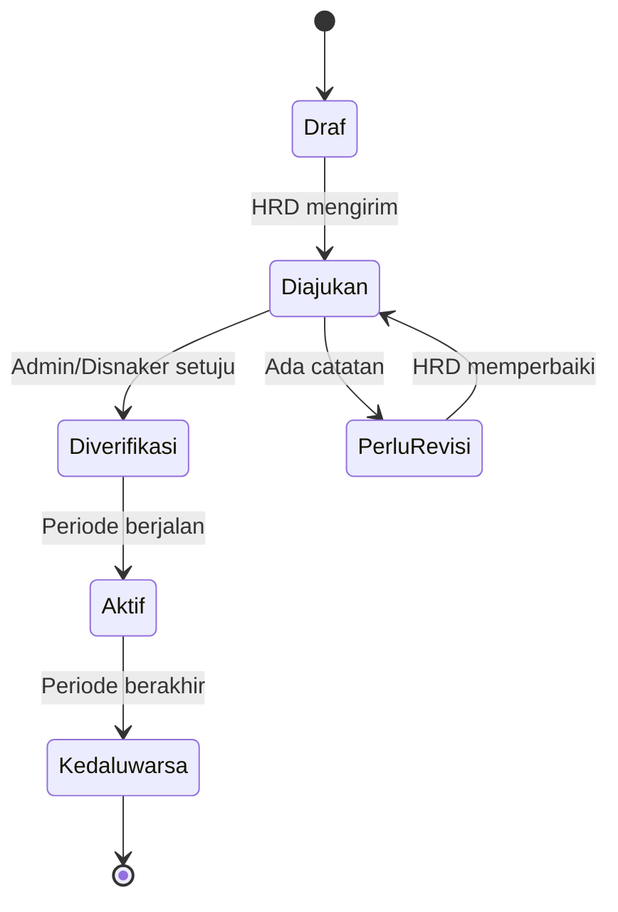
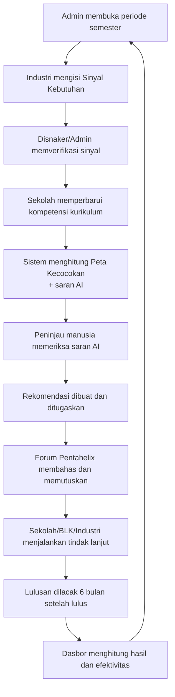
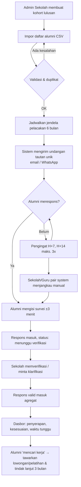
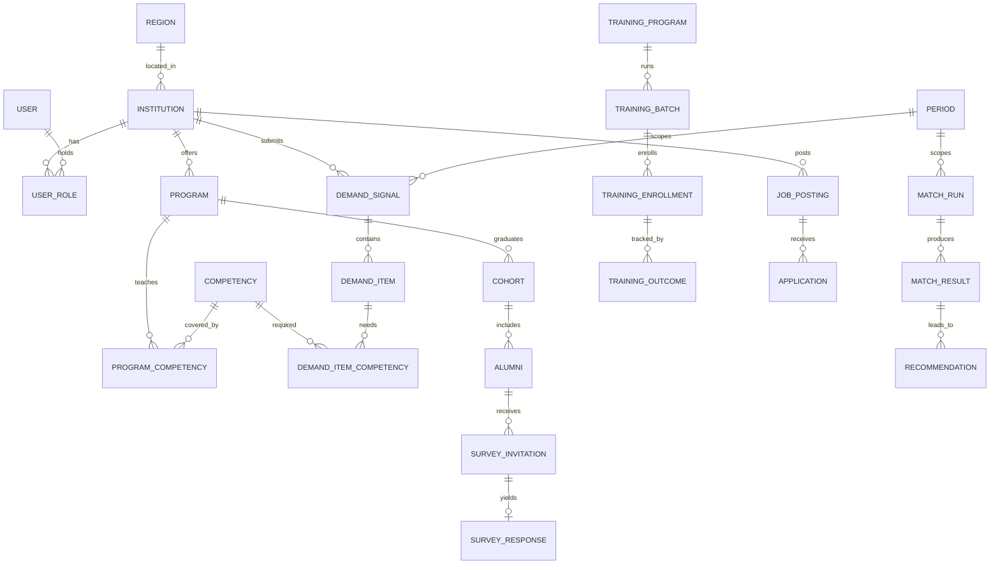

# SINKRON Banten — Spesifikasi Aplikasi Web Lengkap

**Sistem Integrasi Kebutuhan Industri dan Kompetensi Vokasi (SINKRON) Provinsi Banten**
Versi dokumen: 1.0 · Tanggal: 3 November 2026 · Bahasa produk: Bahasa Indonesia

> **Tujuan dokumen.** Spesifikasi produk, fitur, alur, data, keamanan, dan operasional untuk membangun SINKRON Banten sebagai **web app siap pakai oleh masyarakat dan pemerintah daerah**, bukan prototipe. Dokumen ini netral terhadap alat pembuatnya (termasuk Google AI Studio). Tanda **[VERIFIKASI]** berarti hal itu harus dicek ke sumber resmi sebelum dipakai atau diumumkan.

---

## 0. Cara membaca dan memakai dokumen

| Bagian | Isi |
|---|---|
| 1–3 | Ringkasan produk, prinsip, peran pengguna |
| 4 | Arsitektur dan teknologi |
| 5 | **Fitur lengkap per modul** (inti dokumen) |
| 6 | Peta halaman (sitemap) dan komponen |
| 7 | **Alur pengguna end-to-end** (dengan diagram) |
| 8 | Model data |
| 9 | Kontrak API |
| 10 | Definisi indikator dan aturan bisnis |
| 11 | Fitur AI: fungsi, batas, pengaman |
| 12 | Keamanan dan pelindungan data pribadi |
| 13 | Kebutuhan non-fungsional |
| 14 | Deployment dan operasional |
| 15 | Data awal (seed) dan konten |
| 16 | Urutan pembangunan, pengujian, dan daftar periksa go-live |
| 17 | Prasyarat non-teknis agar benar-benar bisa dipakai publik |

Prioritas: **[P1]** wajib ada saat rilis 1.0 · **[P2]** sangat disarankan di 1.0 · **[P3]** tahap lanjut. Semua fitur [P1] dan [P2] termasuk dalam cakupan "siap hosting".

---

## 1. Ringkasan produk

### 1.1 Masalah yang diselesaikan
Pengangguran lulusan pendidikan menengah di Banten tinggi, sementara kebutuhan industri, kurikulum sekolah, program pelatihan, dan hasil lulusan **tidak saling terhubung**. Tidak ada siklus umpan balik yang mengembalikan data kebutuhan industri dan data hasil lulusan ke sekolah dan pembuat kebijakan.

### 1.2 Solusi
SINKRON Banten menjalankan siklus tiga tahap yang berulang tiap semester:

1. **Sinyal** — industri menyatakan kebutuhan kompetensi dengan format baku.
2. **Penyesuaian** — sekolah, Dinas Pendidikan, dan Dinas Tenaga Kerja menyesuaikan jurusan, praktik, magang, dan pelatihan berdasarkan peta kecocokan.
3. **Pelacakan** — lulusan dilacak 6 bulan setelah lulus; hasilnya menjadi umpan balik semester berikutnya.

### 1.3 Pengguna sasaran
Alumni SMK/SMA, sekolah (admin, guru/BKK), perusahaan dan kawasan industri, Dinas Pendidikan, Dinas Tenaga Kerja, Bappeda, perguruan tinggi, lembaga pelatihan/komunitas alumni, media, dan publik umum.

### 1.4 Di luar cakupan (non-goals)
- Bukan portal lowongan kerja umum; lowongan/magang hanya sebagai alat untuk melacak hasil dan menghubungkan sinyal ke penempatan.
- Tidak ada skor atau peringkat individu yang menentukan nasib lulusan. Semua keputusan kurikulum/pelatihan tetap oleh manusia.
- Tidak mengumpulkan NIK, nomor KK, atau dokumen identitas.
- Tidak memproses pembayaran.

### 1.5 Tujuan terukur (usulan, ditetapkan oleh tim koordinasi)
- Tingkat respons pelacakan lulusan per kohort.
- Persentase lulusan terserap dalam 6 bulan.
- Persentase jurusan yang tinjauannya memakai peta kecocokan tiap semester.
- Jumlah industri aktif mengisi sinyal tiap semester.
- Persentase peserta pelatihan BLK yang bekerja dalam 6 bulan.

---

## 2. Prinsip desain

1. **Menyambung, bukan membangun ulang.** Data masuk lewat formulir, impor CSV, dan (bila diizinkan) integrasi; tidak memaksa sistem lama diganti.
2. **Mobile-first.** Mayoritas alumni dan pegawai sekolah mengakses lewat ponsel. Semua alur utama harus nyaman di layar 360 px.
3. **Sederhana untuk pengisi.** Formulir industri ≤ 10 menit; survei alumni ≤ 3 menit.
4. **Manusia memutuskan.** AI memberi saran dengan tingkat keyakinan dan bukti; keputusan akhir ditandai siapa yang menyetujui.
5. **Agregat secara bawaan.** Tampilan kebijakan dan publik hanya data agregat dengan ambang minimal; data pribadi tidak pernah tampil di dasbor.
6. **Transparan.** Setiap angka punya definisi, periode, jumlah responden, dan tingkat respons yang terlihat.
7. **Aksesibel dan inklusif.** WCAG 2.1 AA, kontras tinggi, bahasa sederhana, dukung pembaca layar.
8. **Dapat diaudit.** Semua perubahan penting tercatat (siapa, kapan, apa).

### 2.1 Identitas visual (usulan)
- Nama: **SINKRON Banten**. Tagline: *Menyambungkan sekolah, industri, dan lulusan.*
- Warna: biru tua (#1F5FA8) utama; oranye (#E08A2E) aksen; abu netral; status: hijau/kuning/merah dengan ikon (jangan hanya warna).
- Tipografi: sans-serif jernih (mis. Inter/Noto Sans), ukuran dasar 16 px.
- Mode terang dan gelap; ikon konsisten; komponen standar (tombol, form, tabel, kartu, modal, toast).
- Logo/lambang pemerintah daerah hanya dipakai dengan izin resmi **[VERIFIKASI]**.

---

## 3. Peran pengguna dan hak akses (RBAC)

| Peran | Siapa | Hak utama | Data yang boleh dilihat |
|---|---|---|---|
| **Publik** | Siapa saja tanpa login | Lihat dasbor publik agregat, peta, publikasi, FAQ; lihat lowongan/pelatihan publik | Hanya agregat publik |
| **Alumni** | Lulusan SMK/SMA | Isi survei, kelola profil dan persetujuan, lihat lowongan/magang/pelatihan, melamar | Data diri sendiri |
| **Perusahaan (HRD)** | Perwakilan industri | Isi sinyal kebutuhan, kelola lowongan/magang, nilai lulusan, ikut forum | Data perusahaan sendiri + agregat |
| **Admin Sekolah** | Operator sekolah | Kelola jurusan/kurikulum, impor alumni, jalankan pelacakan, verifikasi respons | Data sekolah sendiri |
| **Guru/BKK** | Guru produktif, koordinator BKK | Tinjau peta kecocokan, kelola magang, tindak lanjut alumni | Data sekolah (terbatas peran) |
| **Disdik** | Dinas Pendidikan Provinsi/cabang | Lihat semua sekolah, setujui/tolak rekomendasi, atur periode, rapor sekolah | Agregat + data sekolah; tidak ada data pribadi alumni |
| **Disnaker** | Dinas Tenaga Kerja/BLK | Kelola pelatihan BLK, lihat sinyal dan hasil pelatihan | Agregat + data peserta pelatihan sendiri |
| **Bappeda/Analis** | Perencana daerah | Dasbor kebijakan, indikator SDGs, laporan terjadwal | Agregat saja |
| **Akademisi** | Dosen/peneliti | Kelola kamus kompetensi (peninjau), evaluasi independen, akses data riset teranonimkan | Agregat/teranonimkan, melalui permintaan terkontrol |
| **Komunitas/Lembaga Pelatihan** | Komunitas alumni, lembaga pelatihan | Kelola katalog pelatihan sendiri, jaringan alumni | Data lembaga sendiri + agregat |
| **Media** | Jurnalis | Akses ruang media: data publik, unduhan, press kit | Agregat publik |
| **Koordinator Provinsi** | Sekretariat tim koordinasi | Kelola forum, tindak lanjut, konten, laporan | Agregat + dokumen forum |
| **Super Admin** | Teknis | Konfigurasi sistem, pengguna, audit | Tanpa akses data pribadi alumni kecuali mekanisme darurat tercatat |

**Aturan umum:**
- Prinsip hak akses minimum; satu pengguna bisa punya lebih dari satu peran per institusi, tetapi tiap peran terikat pada satu institusi.
- Akses data pribadi alumni hanya oleh Admin Sekolah dan Guru/BKK sekolah asal alumni, untuk tujuan pelacakan.
- Dasbor Disdik/Disnaker/Bappeda tidak pernah memuat nama, kontak, atau data identifikasi alumni.
- Akun admin wajib autentikasi dua faktor (2FA).

---

## 4. Arsitektur dan teknologi

### 4.1 Gambaran arsitektur

### 4.2 Teknologi yang disarankan

| Lapisan | Pilihan default | Catatan |
|---|---|---|
| Frontend | React + TypeScript + Vite, Tailwind CSS, komponen aksesibel (mis. Radix/shadcn) | PWA (service worker, manifest, dapat dipasang di ponsel) |
| Peta | MapLibre/Leaflet + GeoJSON batas kabupaten/kota Banten | Data batas dari sumber resmi **[VERIFIKASI lisensi]** |
| Grafik | Recharts/ECharts | Semua grafik punya tabel alternatif untuk aksesibilitas |
| Backend | Node.js (TypeScript) atau Cloud Functions/Cloud Run | REST JSON; validasi skema (zod) |
| Basis data | **Opsi A:** PostgreSQL (disarankan untuk pelaporan/agregasi). **Opsi B:** Firebase Firestore + ekspor ke BigQuery untuk analitik | Pilih satu; bagian 8 ditulis relasional dan bisa dipetakan ke koleksi |
| Autentikasi | Email+sandi dengan verifikasi; OTP; 2FA (TOTP) untuk admin | Penyedia: Firebase Auth atau setara |
| Penyimpanan berkas | Object storage (bucket privat, tautan bertanda waktu) | Dokumen MoU, lampiran, ekspor |
| AI | Gemini API dipanggil **hanya dari server** | Kunci API tidak boleh ada di kode klien |
| Notifikasi | Email transaksional; WhatsApp Business API resmi **[VERIFIKASI biaya dan izin]**; in-app | SMS opsional |
| Hosting | Cloud Run/App Hosting atau setara, CDN, HTTPS wajib | Wilayah server: Indonesia/Asia Tenggara **[VERIFIKASI kebijakan lokasi data]** |
| Observabilitas | Log terstruktur, pemantauan error, uptime check, alarm | Wajib sebelum go-live |
| CI/CD | Repositori Git, build otomatis, lingkungan dev/staging/produksi | Lihat bagian 14 |

> **Catatan alat pembuat.** Alat pembuat aplikasi berbasis AI biasanya menghasilkan frontend dengan cepat, tetapi penyimpanan data, autentikasi, rahasia (secret), dan pemanggilan AI harus dipastikan berjalan **di sisi server** agar layak untuk publik. Cek kemampuan terbaru alat saat membangun **[VERIFIKASI]**.

### 4.3 Multi-wilayah dan konfigurasi
- Aplikasi **multi-tenant per wilayah**: kabupaten/kota (8 wilayah Banten) sebagai dimensi tetap; tiap institusi terikat wilayah.
- Bendera fitur (feature flags) untuk mengaktifkan modul per tahap pilot.
- Periode semester dikonfigurasi admin (tanggal buka/tutup sinyal, jendela pelacakan).
- Semua teks antarmuka dapat diubah lewat berkas bahasa (i18n); bahasa bawaan Indonesia.

---

## 5. Fitur lengkap per modul

Format tiap modul: **Tujuan → Pengguna → Fitur → Aturan/validasi → Kriteria selesai**.

### 5.1 Akun, pendaftaran, dan onboarding

**Tujuan:** setiap pengguna terverifikasi sesuai perannya sebelum bisa mengakses data.
**Pengguna:** semua peran.

**Fitur**
- **[P1]** Pendaftaran per peran dengan formulir berbeda:
  - *Alumni:* nama, tahun lulus, sekolah, jurusan (dipilih dari daftar), email dan/atau nomor ponsel. Alumni juga dapat masuk lewat **tautan unik undangan** dari sekolah tanpa membuat sandi (akses survei tunggal).
  - *Perusahaan:* nama perusahaan, NIB/identitas usaha (opsional), sektor, kabupaten/kota, jumlah karyawan, kontak HRD, email perusahaan.
  - *Sekolah:* NPSN, nama, jenis (SMK/SMA), kabupaten/kota, kontak admin.
  - *Dinas/Bappeda/Kampus/Lembaga/Media:* nama institusi, jabatan, email institusi.
- **[P1]** Verifikasi email (tautan) dan/atau nomor ponsel (OTP).
- **[P1]** **Verifikasi institusi oleh admin**: akun sekolah, perusahaan, dinas, kampus, lembaga pelatihan berstatus *Menunggu verifikasi* sampai disetujui (cek dokumen/pihak berwenang). Alumni diverifikasi lewat undangan sekolah atau pencocokan data oleh Admin Sekolah.
- **[P1]** Persetujuan (consent) eksplisit saat daftar: tujuan data, siapa yang bisa melihat, hak pengguna. Versi teks persetujuan dicatat.
- **[P1]** Masuk, keluar, lupa/ubah sandi, sesi aman, kunci akun setelah percobaan gagal berulang.
- **[P1]** 2FA (TOTP) wajib untuk Admin Sekolah, Disdik, Disnaker, Bappeda, Koordinator, Super Admin; opsional untuk lainnya.
- **[P1]** Undang pengguna: Admin institusi mengundang rekan (peran terbatas) lewat email.
- **[P2]** Panduan awal (onboarding tour) per peran; daftar tugas awal (checklist).
- **[P2]** Pengelolaan perangkat/sesi aktif.

**Aturan**
- Satu email = satu akun. Perubahan peran hanya oleh admin institusi/Super Admin dan tercatat.
- Sandi minimal 10 karakter, dicek terhadap daftar sandi umum; tidak ada pertanyaan keamanan.
- Akun alumni berusia di bawah 18 tahun: tidak dapat dibuat sendiri; data dikelola lewat sekolah dengan dasar persetujuan wali sesuai kebijakan **[VERIFIKASI ketentuan anak dalam UU PDP]**.

**Kriteria selesai:** semua peran dapat mendaftar, diverifikasi, dan masuk; akun belum terverifikasi tidak melihat data internal; percobaan akses lintas peran ditolak dan tercatat.

---

### 5.2 Beranda publik dan dasbor publik

**Tujuan:** transparansi dan pintu masuk bagi masyarakat, media, dan calon mitra.
**Pengguna:** Publik.

**Fitur**
- **[P1]** Halaman beranda: penjelasan siklus Sinyal–Penyesuaian–Pelacakan, angka kunci (agregat), tombol daftar per peran.
- **[P1]** Dasbor publik: TPT dan indikator hasil lulusan **agregat** per kabupaten/kota, tren per semester, kebutuhan kompetensi teratas per sektor, tingkat partisipasi industri dan sekolah. Setiap kartu menampilkan *definisi*, *periode*, *jumlah responden*, *tingkat respons*, dan *sumber*.
- **[P1]** Peta interaktif Banten (kabupaten/kota) dengan pilihan indikator; tabel alternatif.
- **[P1]** Halaman Tentang, Cara Kerja, FAQ, Kontak, Kebijakan Privasi, Syarat Penggunaan, Aksesibilitas.
- **[P2]** Katalog **lowongan/magang publik** dan **pelatihan BLK** (lihat 5.10 dan 5.11) tanpa perlu login untuk melihat.
- **[P2]** Publikasi: laporan semester, ringkasan kebijakan, rilis media (diunggah Koordinator).
- **[P2]** Berlangganan buletin (email) dengan persetujuan ganda (double opt-in).

**Aturan:** sel dengan responden di bawah ambang (bagian 10.6) ditampilkan sebagai "data belum cukup"; tidak ada nama sekolah di data publik kecuali sekolah memberi izin tampil di "rapor publik" (opsional).

**Kriteria selesai:** semua angka publik dapat ditelusuri ke definisi; halaman lolos pemeriksaan aksesibilitas dasar; tidak ada data pribadi di sumber halaman maupun API publik.

---

### 5.3 Kamus Kompetensi (taksonomi bersama)

**Tujuan:** satu bahasa bersama agar kebutuhan industri, kurikulum, dan hasil lulusan bisa dibandingkan.
**Pengguna:** Akademisi (penyusun/peninjau), Koordinator, Disdik, Disnaker, Super Admin; dibaca semua peran.

**Struktur**
- Sektor industri → Bidang/Rumpun → **Kompetensi** (nama, deskripsi, tingkat 1–5, jenis: teknis/non-teknis/sertifikasi) → Sinonim/istilah lain.
- Pemetaan opsional ke acuan resmi: kode SKKNI dan jenjang KKNI **[VERIFIKASI kode dan redaksi resmi]**; pemetaan ke program keahlian SMK **[VERIFIKASI spektrum keahlian terbaru Kemendikdasmen]**.

**Fitur**
- **[P1]** Pencarian dan jelajah kompetensi (pohon + pencarian teks).
- **[P1]** Penambahan/penyuntingan kompetensi oleh peninjau dengan **alur persetujuan** (draf → ditinjau → disetujui → arsip) dan **versi** (riwayat perubahan, tanggal berlaku).
- **[P1]** Usulan kompetensi baru oleh pengguna (industri/sekolah) bila istilah tidak ditemukan; masuk antrean tinjauan.
- **[P1]** Pengelolaan sinonim dan kata kunci pencarian.
- **[P2]** Penggabungan duplikat (merge) dengan pemetaan ulang data lama.
- **[P2]** Impor/ekspor CSV kamus; tampilan perbedaan antarversi.
- **[P2]** Penanda kompetensi *baru/menurun* berdasarkan tren permintaan.

**Aturan:** kompetensi yang sudah dipakai tidak boleh dihapus, hanya diarsipkan; perubahan versi tidak mengubah data historis (tiap sinyal menyimpan versi kamus yang dipakai).

**Kriteria selesai:** minimal kamus awal untuk sektor prioritas Banten tersedia (bagian 15); alur usulan–tinjauan berjalan; pencarian toleran salah ketik.

---

### 5.4 Sinyal Industri (kebutuhan kompetensi)

**Tujuan:** industri menyampaikan kebutuhan kompetensi tiap semester dengan format baku.
**Pengguna:** Perusahaan (HRD); dibaca Disdik, Disnaker, Sekolah (agregat/anonim sesuai pilihan perusahaan).

**Alur status:** `Draf → Diajukan → Diverifikasi → Aktif → Kedaluwarsa` (atau `Ditolak/Perlu revisi`).

**Fitur**
- **[P1]** Formulir sinyal per periode semester dengan baris kebutuhan (satu baris per posisi):
  - posisi/jabatan (teks bebas + dipetakan ke kamus), kompetensi teknis (pilih dari kamus, boleh banyak), kompetensi non-teknis, sertifikasi yang diperlukan, tingkat pendidikan minimum, **jumlah kebutuhan perkiraan** (rentang), lokasi kerja (kabupaten/kota), jenis hubungan kerja, **kesiapan menerima magang** (ya/tidak, jumlah slot), prioritas (tinggi/sedang/rendah), catatan.
- **[P1]** Pilihan **visibilitas**: nama perusahaan tampil / hanya sektor dan wilayah (anonim). Bawaan: anonim pada tampilan sekolah dan publik.
- **[P1]** Penyimpanan otomatis (autosave), draf, validasi per baris, pratinjau sebelum kirim.
- **[P1]** **Salin dari semester sebelumnya** lalu ubah.
- **[P1]** Verifikasi sinyal oleh Disnaker/admin (cek kewajaran, duplikasi, perusahaan terdaftar).
- **[P1]** Riwayat dan versi sinyal; ekspor PDF/CSV milik sendiri.
- **[P2]** **Impor CSV** untuk perusahaan besar dengan banyak posisi; templat unduhan.
- **[P2]** Normalisasi otomatis teks posisi/kompetensi ke kamus dengan saran AI dan persetujuan pengguna (bagian 11).
- **[P2]** Pengingat otomatis menjelang penutupan periode; dukungan pengisian untuk asosiasi kawasan industri (satu akun asosiasi dapat mengajukan atas nama banyak anggota, dengan persetujuan anggota).
- **[P3]** Penyederhanaan untuk UMKM: formulir singkat 5 isian.

**Aturan:** satu sinyal aktif per perusahaan per periode (boleh banyak baris); jumlah kebutuhan harus angka positif; sinyal tanpa kompetensi dari kamus tidak dapat diajukan (boleh mengusulkan kompetensi baru); periode tertutup tidak dapat diubah kecuali dibuka admin dengan alasan tercatat.

**Kriteria selesai:** industri dapat mengisi, mengajukan, merevisi, dan melihat statusnya; agregat kebutuhan per sektor/wilayah muncul di dasbor setelah verifikasi.

---

### 5.5 Jurusan dan kurikulum sekolah

**Tujuan:** menyimpan kompetensi yang benar-benar diajarkan tiap jurusan agar bisa dicocokkan.
**Pengguna:** Admin Sekolah, Guru/BKK; dibaca Disdik.

**Fitur**
- **[P1]** Profil sekolah: NPSN, alamat, kontak, jurusan/program keahlian aktif, jumlah lulusan per tahun.
- **[P1]** Per jurusan: daftar **kompetensi yang diajarkan** (dari kamus) dengan tingkat penguasaan lulusan (1–5), porsi praktik, dan status (inti/pilihan).
- **[P1]** Unggah dokumen kurikulum (PDF) sebagai lampiran; **[P2]** ekstraksi otomatis kompetensi dari dokumen ke usulan daftar kompetensi (dengan tinjauan manual).
- **[P1]** Riwayat perubahan kurikulum per tahun ajaran.
- **[P2]** Data kemitraan sekolah–industri (mitra, jenis kerja sama, jumlah siswa magang).
- **[P2]** Impor data jurusan/lulusan dari CSV.

**Aturan:** kompetensi harus dari kamus atau diusulkan; perubahan kurikulum menciptakan versi baru yang ditautkan ke tahun ajaran.

**Kriteria selesai:** tiap jurusan punya profil kompetensi yang bisa dibaca modul Peta Kecocokan.

---

### 5.6 Peta Kecocokan (pencocokan kebutuhan vs kurikulum)

**Tujuan:** menunjukkan jurusan mana yang sudah/belum mencakup kompetensi yang dibutuhkan industri.
**Pengguna:** Disdik, Disnaker, Admin Sekolah, Guru/BKK; dibaca Bappeda dan Akademisi.

**Fitur**
- **[P1]** Matriks **Jurusan × Kompetensi yang dibutuhkan** berwarna: *tercakup penuh / sebagian / belum*, dengan angka permintaan (agregat) dan pasokan lulusan.
- **[P1]** **Skor kecocokan** per jurusan dan per sektor/wilayah (rumus di bagian 10.3), dengan rincian celah.
- **[P1]** Filter: periode, kabupaten/kota, sektor, jurusan, sekolah.
- **[P1]** **Daftar celah teratas**: kompetensi dengan permintaan tinggi dan cakupan rendah.
- **[P1]** Penjelasan tiap sel: bukti (kutipan kompetensi sinyal dan kurikulum yang dicocokkan).
- **[P2]** **Saran pencocokan AI** untuk memetakan kompetensi teks bebas ke kamus dan menilai cakupan; setiap saran punya *tingkat keyakinan*; yang di bawah ambang masuk **antrean tinjauan manusia** (bagian 11).
- **[P2]** Perbandingan antar-semester dan antar-sekolah (agregat).
- **[P2]** Ekspor matriks (CSV/PDF) dan tautan berbagi internal.
- **[P3]** Simulasi "bagaimana jika": menambah modul praktik atau slot magang dan melihat dampak ke skor.

**Aturan:** skor ditampilkan bersama jumlah sinyal dan sekolah yang mendasarinya; skor dengan data tidak cukup diberi label; tinjauan manusia tercatat (siapa, kapan, keputusan).

**Kriteria selesai:** peta dapat dihasilkan otomatis tiap periode; tiap angka dapat ditelusuri ke bukti; saran AI tidak pernah otomatis mengubah data tanpa persetujuan.

---

### 5.7 Rekomendasi dan tindak lanjut

**Tujuan:** mengubah temuan peta menjadi tindakan yang dilacak.
**Pengguna:** Disdik, Disnaker, Admin Sekolah, Guru/BKK, Koordinator.

**Alur status:** `Usulan → Dalam pembahasan → Diterima → Dijalankan → Selesai` atau `Ditolak (dengan alasan)`.

**Fitur**
- **[P1]** Rekomendasi otomatis dari celah (mis. tambah praktik, modul tambahan, slot magang, pelatihan BLK) sebagai **usulan**, dapat disunting manual.
- **[P1]** Penugasan ke pihak (sekolah, Disdik, Disnaker, industri), tenggat, penanggung jawab, komentar, lampiran.
- **[P1]** Keputusan menerima/menolak wajib berisi alasan; riwayat keputusan terbuka bagi pihak terkait.
- **[P1]** Pelacakan hasil: setelah rekomendasi selesai, sistem membandingkan indikator semester berikutnya.
- **[P2]** Notifikasi pengingat tenggat; ringkasan mingguan.

**Kriteria selesai:** setiap celah teratas dapat dijadikan rekomendasi dan dipantau sampai ada hasil terukur.

---

### 5.8 Data alumni dan Pelacak Lulusan

**Tujuan:** mengukur hasil lulusan 6 bulan setelah lulus, dengan beban pengisian rendah dan privasi terjaga.
**Pengguna:** Admin Sekolah, Guru/BKK (kelola); Alumni (isi); Disdik/Disnaker/Bappeda (agregat).

**Alur lengkap:** lihat bagian 7.4.

**Fitur — pengelolaan kohort (sekolah)**
- **[P1]** Buat **kohort lulusan** per jurusan dan tahun lulus.
- **[P1]** **Impor daftar alumni** (CSV/Excel dengan templat): nama, jurusan, tahun lulus, kontak (email/ponsel), NISN opsional. Validasi baris, laporan kesalahan, deteksi duplikat.
- **[P1]** Penjadwalan pelacakan: jendela default 6 bulan setelah kelulusan; opsi pelacakan lanjutan 12 bulan **[P2]**.
- **[P1]** **Undangan** ke alumni lewat tautan unik (email/WhatsApp) dengan pengingat otomatis (mis. H+0, H+7, H+14), pilihan *berhenti menerima pengingat*.
- **[P1]** Pantau **tingkat respons** per kohort/jurusan; daftar alumni belum merespons (dengan kontak, hanya untuk Admin Sekolah/Guru-BKK).
- **[P1]** **Verifikasi respons** (kolom status: terverifikasi / perlu klarifikasi) oleh sekolah; metode **pair system**: guru/teman sebaya membantu menjangkau yang belum merespons.
- **[P2]** Pengisian oleh sekolah atas nama alumni (via telepon) dengan penanda sumber "diisi petugas".

**Fitur — survei alumni (tanpa/dengan login)**
- **[P1]** Akses lewat tautan unik atau akun; ±10 pertanyaan, bisa dilanjutkan (simpan otomatis), nyaman di ponsel.
- **[P1]** Isi survei:
  1. Status saat ini: bekerja (penuh/paruh waktu/kontrak), wirausaha, magang, melanjutkan studi, mencari kerja, tidak mencari kerja (dengan alasan), lainnya.
  2. Jika bekerja: sektor, jabatan (dipetakan ke kamus), nama perusahaan (opsional), kabupaten/kota kerja, **kesesuaian dengan jurusan** (sangat/sebagian/tidak), **waktu tunggu** (bulan sampai pekerjaan pertama), kisaran penghasilan (opsional, rentang).
  3. Jika mencari kerja: durasi, kendala utama (daftar pilihan), kompetensi yang dirasa kurang (dari kamus), bantuan yang dibutuhkan.
  4. Kompetensi sekolah yang paling berguna dan yang kurang (dari kamus).
  5. Persetujuan: boleh dihubungi untuk info lowongan/pelatihan? boleh datanya dipakai untuk riset teranonimkan?
- **[P1]** Pernyataan privasi singkat di awal; tidak ada pertanyaan sensitif di luar kebutuhan.
- **[P1]** Halaman terima kasih dengan tautan ke lowongan/pelatihan yang relevan (jika setuju dihubungi).
- **[P2]** Pelacakan ulang bila status "mencari kerja" (tindak lanjut 3 bulan).

**Aturan:** satu undangan = satu respons aktif (boleh diperbarui sampai jendela ditutup); respons ganda dari orang yang sama digabung; data kontak tidak pernah tampil di dasbor; respons yang ditandai tidak valid dikecualikan dari agregat dengan alasan tercatat.

**Kriteria selesai:** sekolah dapat mengimpor, mengundang, memantau, dan memverifikasi; alumni dapat mengisi dari ponsel kurang dari 3 menit; agregat per jurusan/sekolah/wilayah muncul di dasbor sesuai ambang.

---

### 5.9 Penilaian pengguna lulusan (suara industri)

**Tujuan:** melengkapi sudut pandang alumni dengan penilaian industri atas kompetensi lulusan.
**Pengguna:** Perusahaan; dibaca agregat.

**Fitur**
- **[P2]** Survei singkat industri per semester: jumlah lulusan SMK/SMA yang dipekerjakan, penilaian kompetensi teknis dan non-teknis (skala), kompetensi yang paling kurang, kepuasan, kesediaan menambah slot magang.
- **[P2]** Penilaian dikaitkan ke sektor/wilayah (bukan ke individu alumni).
- **[P2]** Hasil masuk ke Peta Kecocokan sebagai *sinyal pendukung*.

**Kriteria selesai:** hasil agregat tampil di dasbor dan rekomendasi.

---

### 5.10 Lowongan dan magang

**Tujuan:** menyambungkan kebutuhan industri ke alumni dan mencatat hasil penempatan.
**Pengguna:** Perusahaan (publikasi), Alumni (cari/lamar), Sekolah/BKK (pantau), Disnaker (agregat).

**Fitur**
- **[P2]** Perusahaan membuat **lowongan kerja** dan **lowongan magang**: judul, deskripsi, kompetensi (dari kamus), lokasi, jumlah, tenggat, jenis, kontak/lamaran (internal atau tautan eksternal).
- **[P2]** Moderasi lowongan (anti-penipuan): verifikasi perusahaan, tombol *laporkan lowongan*, penangguhan otomatis bila banyak laporan.
- **[P2]** Alumni mencari dengan filter (jurusan, kompetensi, wilayah, jenis), menyimpan, dan melamar dengan profil singkat (tanpa unggah dokumen sensitif; CV opsional).
- **[P2]** Pelacakan status lamaran: *dikirim → dilihat → proses → diterima/ditolak* (diisi perusahaan) sebagai sumber data penempatan.
- **[P2]** Rekomendasi lowongan berdasarkan kompetensi (aturan kecocokan, bukan skor penilaian individu), hanya bila alumni mengizinkan.
- **[P2]** Magang: kuota, periode, status (berjalan/selesai), umpan balik magang dari sekolah dan industri.
- **[P2]** Data penempatan (diterima) diintegrasikan ke pelacak sebagai *indikasi*, tetap diverifikasi lewat survei.

**Aturan:** lowongan wajib mencantumkan perusahaan terverifikasi; tidak ada biaya pendaftaran dari pelamar; larangan diskriminasi (jenis kelamin, agama, disabilitas, dll.) dalam kriteria kecuali diwajibkan hukum; lowongan kedaluwarsa otomatis.

**Kriteria selesai:** alur lowongan–lamaran–hasil berjalan dan hasilnya terhitung di indikator penempatan.

---

### 5.11 Pelatihan BLK dan lembaga pelatihan

**Tujuan:** pelatihan dipilih berdasarkan sinyal industri dan keberhasilannya diukur dari penyerapan kerja.
**Pengguna:** Disnaker/BLK, Lembaga Pelatihan/Komunitas, Alumni/Publik (cari), Bappeda (agregat).

**Fitur**
- **[P2]** **Katalog pelatihan**: judul, kompetensi yang dilatih (dari kamus), durasi, jadwal, lokasi, kuota, biaya, penyelenggara, sertifikasi.
- **[P2]** Rekomendasi program berdasarkan **celah kompetensi** teratas per wilayah (usulan untuk Disnaker).
- **[P2]** Pendaftaran peserta, daftar tunggu, seleksi, kehadiran, kelulusan, penerbitan sertifikat (unggah/tautan).
- **[P2]** **Pelacakan hasil pelatihan**: survei pasca-pelatihan (1, 3, 6 bulan): bekerja/tidak, kesesuaian, penghasilan opsional.
- **[P2]** Laporan **efektivitas** per program: tingkat kelulusan, tingkat penyerapan, waktu tunggu; perbandingan antarprogram.
- **[P3]** Beasiswa/pendanaan pelatihan dan voucher (bila ada kebijakan).

**Kriteria selesai:** tiap program pelatihan punya indikator hasil (penyerapan kerja), bukan hanya jumlah peserta.

---

### 5.12 Dasbor kebijakan (Disdik, Disnaker, Bappeda)

**Tujuan:** menjawab pertanyaan kebijakan dengan data yang bisa ditelusuri.
**Pengguna:** Disdik, Disnaker, Bappeda, Koordinator, Akademisi (agregat).

**Pertanyaan yang harus bisa dijawab**
1. Kompetensi apa yang paling dibutuhkan industri per sektor dan wilayah?
2. Jurusan/wilayah mana yang punya kesenjangan terbesar?
3. Bagaimana penyerapan lulusan per jurusan, sekolah, kabupaten/kota, dan tren?
4. Apakah pelatihan BLK berhasil mengantar peserta bekerja?
5. Rekomendasi mana yang sudah dijalankan dan apa hasilnya?
6. Seberapa baik partisipasi industri dan sekolah (cakupan dan tingkat respons)?

**Fitur**
- **[P1]** Ringkasan eksekutif: KPI utama, perubahan dari semester lalu, peringatan kualitas data (respons rendah).
- **[P1]** Halaman per tema: Kebutuhan Industri, Kecocokan Jurusan, Hasil Lulusan, Pelatihan, Rekomendasi, Partisipasi.
- **[P1]** Filter global: periode, wilayah, sektor, jurusan, jenis sekolah (SMK/SMA), gender (agregat), difabel (agregat, hanya bila ambang terpenuhi).
- **[P1]** Peta kabupaten/kota + tabel; **drill-down** dari provinsi → kabupaten/kota → sekolah (sekolah hanya terlihat oleh Disdik dan sekolah itu sendiri).
- **[P1]** **Rapor sekolah** (internal): penyerapan, kesesuaian, kecocokan kurikulum, tingkat respons, dibanding rata-rata provinsi.
- **[P1]** Penekanan sel kecil (suppression) otomatis sesuai ambang (10.6) dan label kualitas data.
- **[P1]** Ekspor tabel (CSV) dan laporan (PDF) dengan metadata definisi, periode, dan tanggal ekspor.
- **[P2]** **Laporan terjadwal** (otomatis email tiap semester) dan templat laporan SDGs (indikator relevan).
- **[P2]** Narasi insight otomatis oleh AI dari angka yang tersedia, bertanda "dibuat AI, ditinjau manusia" (bagian 11).
- **[P2]** Peringatan dini: jurusan dengan penyerapan turun beruntun atau celah kompetensi melebar.
- **[P3]** Penghubung ke indikator RPJMD/SDGs Banten **[VERIFIKASI indikator resmi]**.

**Kriteria selesai:** enam pertanyaan di atas dapat dijawab langsung dari dasbor; tiap angka punya tombol "lihat definisi dan data pendukung".

---

### 5.13 Forum Pentahelix dan kolaborasi

**Tujuan:** menjalankan tata kelola kolaborasi lima unsur secara terdokumentasi.
**Pengguna:** Koordinator Provinsi, wakil unsur Pemerintah, Bisnis, Akademisi, Komunitas, Media.

**Fitur**
- **[P2]** **Direktori mitra**: profil institusi, unsur pentahelix, wilayah, minat kerja sama.
- **[P2]** **Repositori kesepakatan (MoU/PKS)**: unggah, tanggal berlaku, pihak, status (aktif/berakhir), pengingat perpanjangan; akses berdasarkan peran.
- **[P2]** **Forum semester**: undangan, agenda otomatis dari data (celah teratas dan rekomendasi), daftar hadir, notulen, keputusan, tindak lanjut (terhubung ke 5.7).
- **[P2]** **Papan tindak lanjut** lintas unsur (to-do dengan penanggung jawab dan tenggat).
- **[P2]** Voting prioritas (mis. pilih kompetensi prioritas pelatihan) dengan bobot per unsur yang dapat dikonfigurasi.
- **[P3]** Penilaian kolaborasi: indikator keterlibatan tiap unsur (partisipasi, kontribusi data, tindak lanjut selesai).

**Kriteria selesai:** satu siklus forum (undangan → rapat → keputusan → tindak lanjut) dapat dijalankan dan terekam.

---

### 5.14 Ruang media dan data terbuka

**Tujuan:** akuntabilitas publik dan pemanfaatan data oleh media dan peneliti.
**Pengguna:** Media, Akademisi, Publik.

**Fitur**
- **[P2]** Ruang media: ringkasan capaian, infografik, kutipan data bersumber, kontak humas, unduhan CSV agregat.
- **[P2]** **API publik** read-only untuk data agregat (batas permintaan, kunci API gratis, dokumentasi).
- **[P2]** **Permintaan akses data riset** (teranonimkan): formulir tujuan riset, persetujuan etik/izin, persetujuan Koordinator, perjanjian penggunaan, akses terbatas waktu, semua tercatat.
- **[P2]** Lisensi data (usulan CC BY) dan kamus data publik.
- **[P3]** Widget sematan (embed) grafik untuk situs media/dinas.

**Kriteria selesai:** media dapat mengutip data dengan sumber dan definisi; peneliti dapat meminta akses lewat proses terkontrol.

---

### 5.15 Notifikasi dan pengingat

- **[P1]** Notifikasi **in-app** (lonceng) dan **email** transaksional: verifikasi akun, status sinyal, undangan survei, pengingat, rekomendasi baru, tindak lanjut jatuh tempo.
- **[P1]** Pengaturan preferensi notifikasi per jenis dan kanal; tautan berhenti berlangganan di semua email non-penting.
- **[P2]** **WhatsApp** (akun bisnis resmi, templat disetujui) untuk undangan dan pengingat survei **[VERIFIKASI biaya, kebijakan, dan persetujuan penerima]**.
- **[P2]** Penjadwal (scheduler) untuk pengingat periodik; batas frekuensi agar tidak mengganggu (maks. 3 pengingat per undangan).
- **[P2]** Log pengiriman dan status (terkirim/gagal/dibuka) untuk Admin.

**Aturan:** tidak ada pesan promosi; pesan hanya sesuai tujuan yang disetujui; penerima dapat berhenti kapan saja.

---

### 5.16 Privasi dan hak subjek data

- **[P1]** Halaman **Privasi Saya**: lihat data yang disimpan, unduh salinan (JSON/CSV), perbarui data, **tarik persetujuan**, minta penghapusan akun/data.
- **[P1]** Alur **permintaan hak subjek data**: diajukan → diverifikasi → diproses → selesai dalam tenggat yang ditetapkan **[VERIFIKASI tenggat menurut UU PDP]**; tercatat dan dapat diaudit.
- **[P1]** **Log persetujuan** (apa, versi teks, waktu, kanal).
- **[P1]** Kebijakan privasi dan pemberitahuan pemrosesan yang jelas dan mudah dibaca.
- **[P1]** Anonimisasi saat penghapusan: respons survei dipertahankan hanya dalam bentuk teranonimkan/agregat bila ada dasar yang sah.
- **[P2]** Pusat transparansi: siapa yang pernah mengakses data pribadi seseorang (jejak akses untuk alumni).
- **[P2]** Prosedur dan formulir pelaporan insiden/kebocoran data.

---

### 5.17 Konsol admin

- **[P1]** Manajemen pengguna dan institusi: verifikasi, penangguhan, penggantian peran, reset 2FA (dengan verifikasi).
- **[P1]** Konfigurasi **periode** (semester, jendela sinyal, jendela pelacakan), wilayah, sektor, ambang agregasi, bobot.
- **[P1]** Kelola kamus kompetensi, templat survei, templat notifikasi.
- **[P1]** **Audit log** terfilter (siapa, kapan, aksi, objek, IP), tidak dapat diubah, diekspor terbatas.
- **[P1]** Moderasi: laporan lowongan, antrean tinjauan AI, usulan kompetensi, antrean verifikasi.
- **[P1]** Pengelola konten (CMS ringan): halaman statis, FAQ, publikasi, banner pengumuman.
- **[P2]** Kesehatan sistem: status layanan, antrean pekerjaan latar belakang, pemakaian API, biaya layanan AI.
- **[P2]** Manajemen kunci API publik; pembatasan laju per kunci.
- **[P2]** Pencadangan dan pemulihan (UI untuk memicu snapshot, riwayat backup).
- **[P2]** Impersonasi **tanpa akses data pribadi** untuk membantu pengguna (mode lihat saja, tercatat, perlu persetujuan pengguna).

---

### 5.18 Bantuan dan dukungan

- **[P1]** Pusat bantuan: FAQ per peran, panduan langkah demi langkah (teks + gambar), video singkat **[P3]**.
- **[P1]** Formulir kontak/tiket dukungan dengan kategori, status, dan balasan; waktu respons ditargetkan.
- **[P2]** **Asisten bantuan AI** untuk pertanyaan penggunaan (bukan konsultasi pribadi/hukum), bersumber hanya dari pusat bantuan; selalu menyediakan jalur ke manusia (bagian 11.5).
- **[P1]** Halaman status sistem sederhana dan pengumuman pemeliharaan.

---

### 5.19 Pelaporan dan ekspor

- **[P1]** Laporan semester standar (PDF): ringkasan indikator, peta celah, penyerapan, rekomendasi, kualitas data.
- **[P1]** Ekspor CSV agregat dengan kamus data dan metadata.
- **[P2]** Templat laporan untuk indikator SDGs dan perencanaan daerah **[VERIFIKASI format yang diminta Bappeda]**.
- **[P2]** Penjadwalan laporan otomatis ke daftar penerima terverifikasi.
- **[P1]** Semua ekspor mematuhi ambang agregasi dan tercatat di audit log.

---

## 6. Peta halaman (sitemap) dan komponen

### 6.1 Halaman publik (tanpa login)

| Rute | Halaman | Isi dan komponen |
|---|---|---|
| `/` | Beranda | Hero, siklus 3 tahap, angka kunci, CTA daftar per peran, berita terbaru |
| `/cara-kerja` | Cara kerja | Alur per peran (ilustrasi), manfaat, contoh |
| `/data` | Dasbor publik | Kartu KPI agregat, grafik tren, filter wilayah/periode, tombol definisi |
| `/peta` | Peta | Peta Banten per kabupaten/kota, pilihan indikator, tabel alternatif |
| `/lowongan`, `/lowongan/:id` | Lowongan/magang | Daftar, filter, detail, tombol lapor |
| `/pelatihan`, `/pelatihan/:id` | Katalog pelatihan | Daftar, filter, detail, daftar/ minat |
| `/publikasi`, `/publikasi/:slug` | Publikasi | Laporan, siaran pers, unduhan |
| `/media` | Ruang media | Press kit, data unduhan, kontak, dokumentasi API |
| `/faq`, `/bantuan` | Bantuan | FAQ per peran, panduan, formulir kontak |
| `/privasi`, `/syarat`, `/aksesibilitas` | Legal | Kebijakan privasi, syarat, pernyataan aksesibilitas |
| `/masuk`, `/daftar`, `/lupa-sandi`, `/verifikasi/:token` | Akun | Formulir masuk/daftar per peran, verifikasi |
| `/survei/:token` | Survei alumni | Survei tanpa sandi via tautan unik |
| `/status` | Status sistem | Ketersediaan layanan, pemeliharaan |

### 6.2 Area terautentikasi per peran

| Area | Rute utama | Fungsi |
|---|---|---|
| **Alumni** | `/alumni` (beranda), `/alumni/survei`, `/alumni/profil`, `/alumni/lowongan`, `/alumni/lamaran`, `/alumni/pelatihan`, `/alumni/privasi` | Tugas (survei), profil, lowongan, lamaran, pelatihan, privasi |
| **Perusahaan** | `/industri`, `/industri/sinyal`, `/industri/sinyal/baru`, `/industri/sinyal/:id`, `/industri/lowongan`, `/industri/magang`, `/industri/penilaian`, `/industri/forum`, `/industri/profil`, `/industri/tim` | Sinyal kebutuhan, lowongan/magang, penilaian lulusan, forum, profil |
| **Sekolah** | `/sekolah`, `/sekolah/profil`, `/sekolah/jurusan`, `/sekolah/jurusan/:id/kompetensi`, `/sekolah/kecocokan`, `/sekolah/alumni`, `/sekolah/alumni/impor`, `/sekolah/pelacakan`, `/sekolah/verifikasi`, `/sekolah/magang`, `/sekolah/rapor`, `/sekolah/rekomendasi` | Kelola jurusan, kurikulum, kohort, pelacakan, rapor, rekomendasi |
| **Pemerintah (Disdik/Disnaker/Bappeda)** | `/pemerintah`, `/pemerintah/kebutuhan`, `/pemerintah/kecocokan`, `/pemerintah/hasil-lulusan`, `/pemerintah/pelatihan`, `/pemerintah/rekomendasi`, `/pemerintah/partisipasi`, `/pemerintah/rapor-sekolah`, `/pemerintah/laporan`, `/pemerintah/forum` | Dasbor, rekomendasi, laporan, pelatihan |
| **Disnaker/BLK** | `/blk/program`, `/blk/angkatan`, `/blk/peserta`, `/blk/hasil` | Kelola pelatihan dan hasil |
| **Akademisi** | `/akademisi/kamus`, `/akademisi/tinjauan`, `/akademisi/evaluasi`, `/akademisi/data-riset` | Kamus, antrean tinjauan, evaluasi independen, permintaan data |
| **Koordinator** | `/koordinator/forum`, `/koordinator/mitra`, `/koordinator/mou`, `/koordinator/tindak-lanjut`, `/koordinator/publikasi` | Tata kelola pentahelix |
| **Admin** | `/admin/pengguna`, `/admin/institusi`, `/admin/periode`, `/admin/kamus`, `/admin/survei`, `/admin/notifikasi`, `/admin/moderasi`, `/admin/konten`, `/admin/audit`, `/admin/sistem`, `/admin/api` | Konfigurasi, moderasi, audit |

### 6.3 Komponen umum (design system)
Navigasi berbasis peran; breadcrumb; tabel dengan sortir/filter/paginasi/ekspor; formulir bertahap dengan penyimpanan otomatis; kartu KPI (nilai, periode, n, tren, tombol definisi); grafik + tabel alternatif; peta; modal konfirmasi untuk aksi berisiko; toast dan banner status; label kualitas data; panel komentar/riwayat; komponen unggah berkas dengan pemindaian ukuran/jenis; pemilih kompetensi (pohon + pencarian); status chip dengan ikon; halaman kosong, galat (403/404/500), dan pemeliharaan.

---

## 7. Alur pengguna end-to-end

### 7.1 Siklus utama tiap semester

### 7.2 Alur Perusahaan: mengisi sinyal
1. Daftar sebagai perusahaan → verifikasi email → menunggu verifikasi institusi.
2. Admin memverifikasi → perusahaan masuk (2FA opsional) → melihat tugas *Isi Sinyal Periode [semester]*.
3. Buka formulir → tambah baris kebutuhan (posisi, kompetensi dari kamus, jumlah, lokasi, magang) → autosave.
4. Jika kompetensi tidak ada → usulkan kompetensi baru (masuk antrean tinjauan; baris dapat disimpan sebagai draf).
5. Pilih visibilitas (anonim/tampil) → pratinjau → kirim.
6. Disnaker/Admin memverifikasi: setuju atau minta revisi (dengan catatan) → status Aktif.
7. Perusahaan melihat ringkasan: bagaimana kebutuhan agregat sektornya, jurusan yang relevan (anonim), dan opsi mengisi lowongan/magang.

### 7.3 Alur Sekolah: kurikulum dan peta
1. Admin Sekolah diverifikasi → melengkapi profil dan jurusan.
2. Per jurusan: pilih kompetensi yang diajarkan, tingkat penguasaan, porsi praktik.
3. Sistem menghitung kecocokan → sekolah membuka *Kecocokan*, melihat celah teratas jurusannya dan bukti.
4. Guru/BKK menindaklanjuti: membuat rekomendasi internal (mis. modul tambahan), atau mengusulkan ke Disdik; mencari mitra magang dari direktori.

### 7.4 Alur pelacakan lulusan (inti)

Langkah rinci:
1. Admin Sekolah mengimpor alumni; sistem menolak baris tanpa kontak atau jurusan tidak dikenal dan melaporkan.
2. Saat jendela pelacakan dibuka, undangan dikirim; alumni membuka tautan, membaca pernyataan privasi, menyetujui (atau menolak) pemakaian data.
3. Alumni mengisi survei (autosave); jika status *mencari kerja*, diberi tombol opsional "izinkan kami menawarkan lowongan/pelatihan".
4. Tingkat respons dipantau di dasbor sekolah; yang belum merespons ditandai.
5. Sekolah memverifikasi respons mencurigakan (mis. waktu isi terlalu singkat, data tidak konsisten).
6. Setelah jendela ditutup, respons valid diagregasi; ambang minimal diterapkan; hasil tampil di dasbor.

### 7.5 Alur alumni: dari tautan ke lowongan
1. Menerima tautan → mengisi survei (tanpa daftar) → pada halaman akhir dapat membuat akun (opsional) untuk melihat lowongan/pelatihan.
2. Dengan akun: kelola profil singkat dan privasi → mencari lowongan/magang → melamar → melihat status.
3. Bila lulus pelatihan BLK: menerima survei pasca-pelatihan.
4. Kapan pun: ubah/tarik persetujuan, unduh data, minta hapus.

### 7.6 Alur Disdik/Disnaker/Bappeda: dari data ke keputusan
1. Buka *Dasbor*: lihat peringatan kualitas data dan KPI; pilih wilayah/sektor.
2. Buka *Kecocokan*: lihat celah teratas; baca bukti; setujui/tolak saran AI (antrean tinjauan).
3. Buat/validasi **rekomendasi**; tugaskan ke sekolah/BLK/industri dengan tenggat.
4. Bawa ke **Forum Pentahelix** (agenda otomatis); catat keputusan dan tindak lanjut.
5. Semester berikutnya: lihat apakah indikator berubah; tutup atau lanjutkan rekomendasi.
6. Ekspor laporan semester untuk perencanaan (RPJMD/SDGs).

### 7.7 Alur Disnaker/BLK: pelatihan berbasis sinyal
1. Lihat celah kompetensi per wilayah → buat program pelatihan (dari kompetensi kamus) → buka pendaftaran.
2. Peserta mendaftar → seleksi → pelatihan (kehadiran) → kelulusan.
3. Survei pasca-pelatihan 1/3/6 bulan → laporan efektivitas (penyerapan) → evaluasi program berikutnya.

### 7.8 Alur Akademisi: kamus dan evaluasi
1. Tinjau usulan kompetensi baru dan saran AI berkeyakinan rendah (antrean).
2. Setujui/gabung/tolak dengan catatan → versi kamus baru.
3. Evaluasi independen: unduh agregat, analisis, unggah laporan evaluasi ke Forum.
4. Mengajukan permintaan data riset teranonimkan → disetujui Koordinator → akses terbatas waktu.

### 7.9 Alur Media/Publik
Buka `/data` → pilih wilayah/indikator → baca definisi → unduh data agregat → kutip dengan sumber. Media dapat membuka ruang media untuk press kit dan kontak humas.

### 7.10 Alur moderasi dan insiden
- Lowongan dilaporkan → antrean moderasi → keputusan (tetap/turunkan/tangguhkan perusahaan) → pelapor diberi tahu.
- Dugaan kebocoran data → Super Admin menandai insiden → kunci akses terkait → pemberitahuan sesuai SOP (bagian 12.7).

---

## 8. Model data

Ditulis relasional; dapat dipetakan ke koleksi dokumen. Semua tabel memiliki `id` (UUID), `created_at`, `updated_at`, `created_by` kecuali dinyatakan lain; data sensitif ditandai 🔒.

### 8.1 Diagram relasi inti

### 8.2 Tabel utama

**Identitas dan akses**

| Tabel | Kolom penting |
|---|---|
| `users` 🔒 | email (unik), phone, password_hash/penyedia auth, name, status (aktif/ditangguhkan), email_verified_at, two_factor_enabled, last_login_at |
| `institutions` | type (sekolah/perusahaan/dinas/bappeda/kampus/lembaga/media/komunitas), name, npsn/nib (opsional), region_id, sector_id (perusahaan), school_level (SMK/SMA), status (menunggu/terverifikasi/ditangguhkan), verified_by, verified_at, visibility_default |
| `user_roles` | user_id, institution_id, role, status, invited_by |
| `regions` | code, name, level (provinsi/kab_kota/kecamatan), parent_id, geometry_ref |
| `consent_logs` 🔒 | user_id/alumni_id, purpose, text_version, granted (bool), channel, timestamp, ip_hash |
| `audit_logs` | actor_id, role, action, object_type, object_id, before/after (ringkas), ip, user_agent, timestamp (append-only) |

**Kamus dan kurikulum**

| Tabel | Kolom penting |
|---|---|
| `sectors` | code, name, parent_id |
| `competencies` | code, name, description, type (teknis/non-teknis/sertifikasi), level_scale, sector_id, skkni_code?, kkni_level?, status (draf/ditinjau/disetujui/arsip), version, effective_from |
| `competency_synonyms` | competency_id, term |
| `competency_versions` | competency_id, version, snapshot, changed_by, reason |
| `programs` | institution_id (sekolah), name, program_code?, level, active_from/to |
| `program_competencies` | program_id, competency_id, mastery_level (1–5), practice_share (%), is_core, curriculum_year, version |
| `curriculum_documents` | program_id, file_ref, year, extracted_status |

**Sinyal dan pencocokan**

| Tabel | Kolom penting |
|---|---|
| `periods` | name (mis. 2026/Ganjil), signal_open/close, tracking_window_start/end, status |
| `demand_signals` | institution_id (perusahaan), period_id, status, visibility (anonim/tampil), submitted_at, verified_by/at, notes, competency_dictionary_version |
| `demand_items` | signal_id, position_title, education_min, headcount_min/max, region_id, contract_type, priority, internship_slots, notes |
| `demand_item_competencies` | item_id, competency_id, required_level, is_certification |
| `competency_suggestions` | source_type, source_id, raw_text, suggested_competency_id, confidence, status (menunggu/diterima/ditolak), reviewed_by |
| `match_runs` | period_id, scope (provinsi/wilayah/sektor), params, started_at, finished_at, algorithm_version, ai_model_version |
| `match_results` | run_id, program_id, competency_id, demand_weight, coverage (0/0.5/1), evidence_refs, confidence, reviewed_status, reviewed_by |
| `recommendations` | match_result_id?, title, description, type (kurikulum/praktik/magang/pelatihan/lainnya), status, assigned_to (institusi), due_date, decision_reason, decided_by |
| `recommendation_outcomes` | recommendation_id, period_id, indicator, before, after, note |

**Alumni dan pelacakan**

| Tabel | Kolom penting |
|---|---|
| `cohorts` | school_id, program_id, graduation_year, tracking_window |
| `alumni` 🔒 | cohort_id, name, gender (opsional), disability (opsional, hanya agregat), contact_email, contact_phone, nisn_hash (opsional), status_data (aktif/opt-out/dihapus), imported_by |
| `survey_templates` | name, version, questions (JSON), active |
| `survey_invitations` | alumni_id, template_id, token_hash, channel, sent_at, reminder_count, status (terkirim/dibuka/selesai/kedaluwarsa), expires_at |
| `survey_responses` 🔒 | invitation_id, status_current (enum), sector_id?, position_competency_id?, employer_name? (opsional), work_region_id?, field_match (sangat/sebagian/tidak), months_to_first_job?, income_range?, barriers (array), missing_competencies (array), useful_competencies (array), consent_contact, consent_research, completed_at, source (mandiri/petugas), validity (valid/perlu_klarifikasi/tidak_valid), verified_by |
| `aggregates_*` | tabel agregat terhitung (periode, wilayah, jurusan, n, nilai, flag_suppressed) — satu-satunya sumber untuk dasbor dan API publik |

**Lowongan dan pelatihan**

| Tabel | Kolom penting |
|---|---|
| `job_postings` | institution_id, type (kerja/magang), title, description, region_id, headcount, deadline, apply_method, status, reported_count |
| `job_posting_competencies` | posting_id, competency_id |
| `applications` 🔒 | posting_id, alumni_id/user_id, status, note, applied_at, status_updated_at |
| `training_programs` | institution_id, title, competency_ids, duration, cost, location, certification, status |
| `training_batches` | program_id, start/end, quota, status |
| `training_enrollments` 🔒 | batch_id, user_id, status (daftar/tunggu/diterima/lulus/tidak_lulus), attendance_pct |
| `training_outcomes` | enrollment_id, month_after (1/3/6), employed (bool), field_match, note |

**Kolaborasi dan operasional**

| Tabel | Kolom penting |
|---|---|
| `mou_agreements` | parties, type, start/end, file_ref, status |
| `forum_sessions` | period_id, date, agenda (JSON, otomatis), minutes, attendance |
| `action_items` | session_id/recommendation_id, owner_institution_id, due_date, status |
| `notifications` | user_id, type, channel, payload, status, sent_at, read_at |
| `support_tickets` | user_id, category, status, messages |
| `data_requests` 🔒 | requester_id, type (akses/koreksi/hapus/tarik_persetujuan/riset), status, due_at, completed_at |
| `research_access` | requester_id, purpose, dataset_scope, approved_by, valid_until, agreement_ref |
| `ai_logs` | function, model_version, input_ref (tanpa PII), output_ref, confidence, human_decision, latency, cost |
| `content_pages` | slug, title, body, status, published_at |
| `api_keys` | owner_id, key_hash, scopes, rate_limit, status |

### 8.3 Aturan data
- **Pseudonimisasi:** identitas alumni (nama, kontak) dipisah dari respons survei di level akses; analitik memakai ID acak.
- **Retensi:** data pribadi alumni dihapus/diteranonimkan setelah masa retensi (usulan: 3 tahun sejak kelulusan atau permintaan hapus lebih awal) **[VERIFIKASI kebijakan]**; agregat disimpan permanen.
- **Integritas:** referensi kamus menyimpan versi; sinyal historis tidak berubah ketika kamus berubah.
- **Pencadangan:** harian dengan retensi 30 hari; uji pemulihan tiap kuartal.

---

## 9. Kontrak API (REST, JSON)

Semua endpoint: HTTPS, autentikasi token (kecuali publik), validasi skema, paginasi (`?page`, `?limit`), kode galat standar (400/401/403/404/409/422/429/500) dengan pesan Indonesia, `X-Request-Id`, dan **otorisasi per peran dan per institusi di sisi server**.

| Grup | Endpoint (contoh) | Peran |
|---|---|---|
| Auth | `POST /auth/register`, `POST /auth/login`, `POST /auth/verify`, `POST /auth/2fa`, `POST /auth/reset` | Publik |
| Pengguna | `GET/PATCH /me`, `GET /me/consents`, `POST /me/data-requests` | Terautentikasi |
| Institusi | `GET/POST/PATCH /institutions`, `POST /institutions/:id/verify`, `POST /institutions/:id/invite` | Admin/Admin institusi |
| Kamus | `GET /competencies`, `POST /competencies`, `PATCH /competencies/:id`, `POST /competencies/:id/approve`, `POST /competencies/suggestions` | Baca: semua; tulis: Akademisi/Admin |
| Periode | `GET/POST/PATCH /periods` | Admin |
| Sinyal | `GET/POST /demand-signals`, `PATCH /demand-signals/:id`, `POST /demand-signals/:id/submit`, `POST /demand-signals/:id/verify`, `POST /demand-signals/import` | Perusahaan, Disnaker/Admin |
| Jurusan | `GET/POST/PATCH /programs`, `PUT /programs/:id/competencies` | Admin Sekolah |
| Kecocokan | `POST /match-runs`, `GET /match-runs/:id`, `GET /match-results`, `POST /match-results/:id/review` | Disdik/Disnaker/Admin; baca: sekolah (data sendiri) |
| Rekomendasi | `GET/POST/PATCH /recommendations`, `POST /recommendations/:id/decision` | Disdik/Disnaker/Sekolah |
| Alumni | `POST /cohorts`, `POST /cohorts/:id/alumni/import`, `GET /cohorts/:id/response-rate` | Admin Sekolah/BKK |
| Pelacakan | `POST /cohorts/:id/invitations/send`, `GET /survey/:token`, `POST /survey/:token/answers`, `POST /survey/:token/submit`, `POST /responses/:id/verify` | Sekolah; alumni via token |
| Lowongan | `GET/POST/PATCH /job-postings`, `POST /job-postings/:id/apply`, `POST /job-postings/:id/report`, `PATCH /applications/:id` | Perusahaan, Alumni, Moderator |
| Pelatihan | `GET/POST/PATCH /training-programs`, `/training-batches`, `POST /training-batches/:id/enroll`, `POST /training-outcomes` | Disnaker/Lembaga, Alumni |
| Dasbor | `GET /analytics/kpi`, `/analytics/map`, `/analytics/gaps`, `/analytics/outcomes`, `/analytics/training`, `/analytics/participation` | Sesuai peran; hanya agregat |
| Laporan | `POST /reports`, `GET /reports/:id/download` | Pemerintah/Koordinator |
| Forum | `GET/POST /forum-sessions`, `/action-items`, `/mou` | Koordinator, unsur |
| AI | `POST /ai/normalize-competency`, `POST /ai/match`, `POST /ai/insight`, `POST /ai/help` | Server-ke-server, peran terkait |
| Notifikasi | `GET /notifications`, `PATCH /notifications/:id/read`, `GET/PATCH /notification-preferences` | Terautentikasi |
| Publik | `GET /public/kpi`, `/public/map`, `/public/postings`, `/public/trainings`, `/public/publications` | Publik (rate limit) |
| API Terbuka | `GET /open/v1/...` (agregat) dengan kunci API | Kunci API |
| Admin | `GET /admin/audit-logs`, `/admin/users`, `/admin/system-health`, `POST /admin/backups` | Admin |

**Kontrak umum respons data agregat:** `{ "indicator", "definition", "period", "scope", "value", "n", "response_rate", "suppressed": false, "source", "generated_at" }`.
